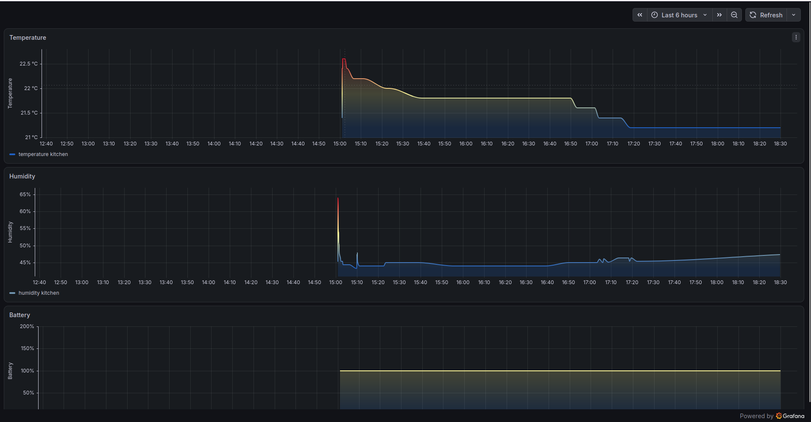

# temp_monitor

## Status

* Work in progress.
* Last done: grafana.
* Next: code refactor to make it more Kotlin, less Java.

## General

A small solution for temperature & other values monitoring at home.

Example dashboard:

Key ideas:

* **Have a working app**, which helps me manage the home heating.
* **Learn while creating** the solution.
* **Enjoy the ride** - have fun coding and solving the problems.

Key flow: Zigbee sensors -> Zigbee2MQTT -> MQTT -> Kotlin app.

## How to run

1. Look for files `*.template` and turn them into real config files by removing the template suffix. To make sure
   everything is filled, grep for `WRITE_HERE_*`.
2. Run `docker compose up -d` from `./docker/` directory.
3. Run the `create_user.sh` script.

## Approach to AI

* AI helps me understand ideas and link everything.
* I author the code and solve problems (unless I really am in a pickle).
* Files created by AI are explicitly marked.